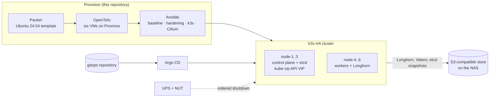

# Homelab Platform

A six-node Kubernetes lab with tested failover, rebuilds and restores: the code
and documentation that take bare Proxmox hosts to a highly available k3s cluster.

Built and run by Mark Lee. Write-ups, the hardware and the rest of the lab are at
[leemark.dev](https://leemark.dev).

## Why

I wanted a cluster where any one machine can fail, and where that claim is
backed by drills rather than diagrams. The first cluster grew by hand: two of
its three control planes shared a host, its templates were built interactively
and nobody could say exactly what was in them. This repository is the rebuild.
Every node is declared in code and can be destroyed and rebuilt from it, the
failure domain is the physical host, and backups count only once a restore has
been proven ([ADR 0011](docs/adr/0011-lab-operating-posture.md)).

## Architecture

Three Proxmox hosts each run one control-plane VM and one worker VM, so losing
a host costs one etcd member and one Longhorn replica and the cluster keeps
quorum. A storage host outside the cluster provides the NAS, the backup servers
and the UPS link.



| Host | Runs |
|---|---|
| pve-1, pve-2 (OptiPlex, i5-12500T) | one control-plane VM + one worker VM each |
| pve-3 (i5-10505) | one control-plane VM + one lighter worker VM, the secondary backup server |
| pve-4 (storage host) | TrueNAS with ZFS, the primary backup server, function-tier VMs, the UPS (NUT master) |
| pve-5 (sandbox) | a disposable single-node pre-production cluster on its own VLAN |

## What's inside

| Layer | What you get |
|---|---|
| **Image** | A Packer template for an identical Ubuntu 24.04 node image with no cluster identity in it ([packer/](packer/)) |
| **VMs** | OpenTofu for the six production VMs and the pre-production node, including disk placement, discard settings and Longhorn disks excluded from image backups ([tofu/](tofu/)) |
| **Nodes** | Ansible roles that build a node end to end: `k3s_node` (config, pinned install, audit policy, Longhorn disk, multipath exclusions), `cilium` (the CNI as a k3s HelmChart), `hardening` (SSH, sysctl, unattended security patches) ([ansible/](ansible/)) |
| **Cluster** | The k3s configs and Helm values as applied: kube-vip, Cilium with LB-IPAM, ingress-nginx, cert-manager with DNS-01, Longhorn, Velero, Argo CD, kube-prometheus-stack, Loki and Alloy ([k3s-v2/live/](k3s-v2/live/README.md)) |
| **Operations** | Health and backup verification scripts, a retry timer for a flaky backup path, an ordered UPS shutdown, and offline tests for the riskiest templates ([scripts/](scripts/), [systemd/](systemd/)) |
| **Docs** | Design, build, operations, testing, backup/DR and traffic-flow docs, the as-built record, four ADRs and seven runbooks |

Kubernetes workloads themselves are not here: Argo CD reconciles them from a
separate gitops repository. Cilium, kube-vip, Sealed Secrets and Argo CD are
the bootstrap tier this repository owns.

## Rebuilding a node

The chain from nothing to a joined node, and what owns each link
([node-rebuild runbook](docs/runbooks/node-rebuild.md)):

Every command runs from the repository root. One-time setup first: copy the
examples and replace the placeholders.

```sh
cp ansible/inventory/hosts.example.yml ansible/inventory/hosts.yml
cp packer/host.pkrvars.hcl.example packer/host-pve-1.pkrvars.hcl   # one per host
cp packer/secrets.auto.pkrvars.hcl.example packer/secrets.auto.pkrvars.hcl
cp tofu/k3s/secrets.auto.tfvars.example tofu/k3s/secrets.auto.tfvars
# packer/http/user-data ships a placeholder password hash. Replace it with the
# output of `mkpasswd -m sha-512`, using the same throwaway ssh_password Packer
# connects with; the build deletes it before the VM becomes a template.
```

Then the chain itself:

```sh
(cd packer && packer build -var-file=host-pve-1.pkrvars.hcl .)     # once per host
(cd tofu/k3s && tofu apply -target='proxmox_virtual_environment_vm.k3s["node-4"]')
(cd ansible && ansible-playbook playbooks/k3s-v2-baseline.yml --limit node-4)
(cd ansible && ansible-playbook playbooks/k3s-node.yml --limit node-4 -e "k3s_token=$K3S_TOKEN")
```

Tokens and credentials are always
supplied at run time and never committed; the roles fail closed when they are
missing rather than building a node that quietly cannot join or back up.

## Verification

Everything below runs offline, without the cluster or Proxmox:

```sh
tofu fmt -check -recursive tofu/
packer fmt -check packer/
(cd ansible && for p in playbooks/*.yml; do ansible-playbook -i inventory/hosts.example.yml --syntax-check "$p"; done)
yamllint -d relaxed k3s-v2/live ansible
shellcheck scripts/*.sh
python3 scripts/test-k3s-version.py           # rebuild pin matches the recorded cluster version
python3 scripts/test-longhorn-multipath.py    # multipath template against storage fixtures
node scripts/check-links.mjs .                 # Markdown links and anchors
```

`scripts/verify-cilium-values.sh` compares the `cilium` role's rendered values
with the live Helm release and needs cluster access; it was the gate for moving
the CNI from a hand-run `helm install` into code
([cilium-adoption runbook](docs/runbooks/cilium-adoption.md)).

## Design decisions

- [ADR 0008](docs/adr/0008-k3s-v2-enterprise-rebuild.md): rebuild k3s as an HA
  cluster with one control plane and one worker per physical host.
- [ADR 0010](docs/adr/0010-k3s-worker-capacity-and-tiered-scheduling.md): grow
  the three workers instead of adding more; keep the older host light with a
  soft taint.
- [ADR 0011](docs/adr/0011-lab-operating-posture.md): nodes are cattle with no
  image backups, the git server lives off the cluster it rebuilds, backups need
  a second copy and a proven restore, and churn happens on pre-production first.
- [ADR 0014](docs/adr/0014-kubeconfig-access-sufficient.md): kubeconfig access
  is enough for a single-operator cluster.

[docs/adr/README.md](docs/adr/README.md) explains why the numbering has gaps.

## Layout

| Path | Contents |
|---|---|
| `packer/` | Node image template and autoinstall answers |
| `tofu/k3s/`, `tofu/preprod/` | Production VMs and the pre-production node, separate state |
| `ansible/` | Roles, playbooks and an example inventory |
| `k3s-v2/` | Cluster docs 01–09, [AS-BUILT.md](k3s-v2/AS-BUILT.md) and the applied configs in `live/` |
| `docs/adr/` | Four architecture decision records |
| `docs/runbooks/` | Disaster recovery, node rebuild, k3s maintenance, Cilium adoption, adding a service, UPS shutdown and the UPS drill |
| `scripts/`, `systemd/` | Verification scripts, offline tests, UPS orchestration, backup retry timer |
| `renovate.json` | Renovate scoped to the Cilium pin only |

## Status

The full 3+3 cluster has been live since 2026-07-06. What has been proven, with
the record for each:

- **Host loss.** On 2026-07-06 one host was hard-stopped with no drain, taking
  down its control-plane node (the VIP leader) and its worker; the API stayed
  available on the VIP ([AS-BUILT](k3s-v2/AS-BUILT.md)).
- **Rebuild from code.** A production worker was destroyed and rebuilt from
  OpenTofu and Ansible on 2026-07-28; all Longhorn volumes returned to three
  replicas. Four defects surfaced on the way and are written up in the
  [runbook](docs/runbooks/node-rebuild.md).
- **Restores.** A Longhorn volume restore came back with an identical sha256, and an etcd
  restore was proven on 2026-07-27
  ([disaster recovery](docs/runbooks/disaster-recovery.md)). Longhorn restores
  now run as a scheduled monthly job from the gitops repository.
- **Power.** The UPS ordered shutdown was drilled on 2026-07-19 and re-drilled
  after retuning ([UPS drill](docs/runbooks/ups-pull-plug-test.md)).

Known limits: two hosts lost at once loses etcd quorum (recovery is
[08 § R5](k3s-v2/08-backup-dr.md#r5--etcd-quorum-loss)); pre-production is a
single node, so it tests charts and upgrades but not replica rebuilds; growing
the Longhorn disks is still pending. The docs in `k3s-v2/` 01–09 are the July
design and say so where reality moved on.

This repository is a curated public copy of a private one. Addresses are
RFC 5737 documentation ranges, hostnames are placeholders (`node-1`…`node-6`,
`pve-1`…`pve-5`, `*.example.com`), and the lab's other services, credentials
and internal planning stay in the private repository.
