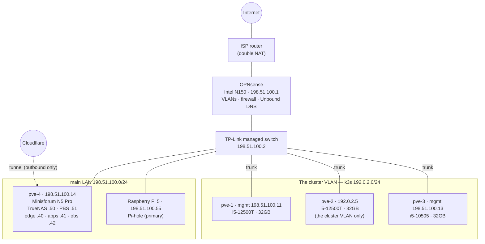
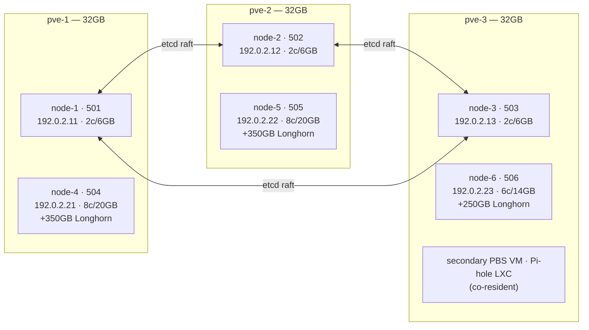
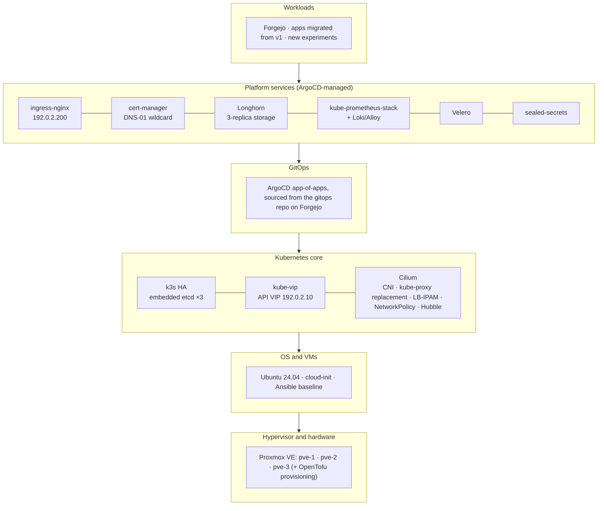

# 01 — Architecture

> **Status (2026-09-25):** design intent, written as the 2026-07 build plan. [AS-BUILT.md](AS-BUILT.md) records what was running at its July 2026 snapshot ([README](README.md)).

The what and the where. For the *why*, see
[02-design-decisions.md](02-design-decisions.md).

## Design Goals

| Goal | Concrete meaning |
|---|---|
| Survive any single physical node failure | etcd quorum holds (2/3), workloads reschedule, ingress IP fails over, with no human action required |
| Reconstructable from Git | `homelab` repo (IaC) + `gitops` repo (manifests) + backups = full rebuild, documented and drilled |
| Operable from the docs alone | every day-2 task is a written workflow in [06-operations.md](06-operations.md) |
| Enterprise-transferable skills | each component maps to a production counterpart ([02 § enterprise mapping](02-design-decisions.md#enterprise-mapping)) |
| Fits the hardware | 3× 32GB mini PCs; the design leaves Proxmox headroom on every host |

**Non-goals:** multi-cluster federation, service mesh, public-cloud
integration, five-nines uptime. This is one cluster, one site, one owner.

---

## Physical Topology

Notes:

- **No WAN port-forwards exist.** All external access enters through the
  Cloudflare tunnel terminating on the edge VM on pve-4 (198.51.100.40). The
  cluster is never directly exposed.
- pve-2 has no 198.51.100.x interface; its Proxmox UI is
  `https://192.0.2.5:8006`.
- pve-3's cluster-VLAN trunk (switch port tag + VLAN-aware `vmbr0`) was a Phase 0
  prerequisite: without it, pve-3 cannot host cluster VMs.

## Virtual Topology — VM Placement

One control plane + one worker per physical host. This is the entire point
of the v2 topology: **the failure domain is the physical node**, and every
cluster function (etcd, scheduling, storage replicas, LB announcement)
tolerates losing exactly one of them.

## Failure Domain Analysis

etcd quorum = ⌈(3+1)/2⌉ = 2. Longhorn default = 3 replicas, one per worker.

| Failure | Control plane | Workloads | Storage | Ingress/LB | External access |
|---|---|---|---|---|---|
| **pve-1 dies** | 2/3 etcd: OK | reschedule to node-5/6 | 2/3 replicas: OK, rebuilds | VIP + LB IPs fail over via ARP | unaffected |
| **pve-2 dies** | 2/3 etcd: OK | reschedule to node-4/6 | 2/3 replicas: OK | fails over | unaffected |
| **pve-3 dies** | 2/3 etcd: OK | reschedule to node-4/5 | 2/3 replicas: OK | fails over | unaffected (edge is on pve-4), but the secondary PBS and secondary Pi-hole are down |
| **pve-4 dies** | unaffected | unaffected | Longhorn OK (local disks); **backup target + NFS bulk class unavailable** | unaffected | **down** (NPM + cloudflared live on pve-4) |
| **Any single VM dies** | if a control VM: 2/3 etcd | if a worker: reschedule | rebuild replica | failover | unaffected |
| **Two physical nodes die** | quorum lost: cluster read-only/down | — | 1/3 replicas (data intact) | down | down for cluster services |

The two-node case is the accepted limit; recovery is
[08-backup-dr.md § R5](08-backup-dr.md#r5--etcd-quorum-loss).

## Component Stack

Layer rule of thumb: **L0–L2 are rebuilt from this repo** (OpenTofu +
Ansible + k3s configs); **L3–L5 are rebuilt from the gitops repo** (ArgoCD
reconciles everything above the Kubernetes core). The seam between the two
is the ArgoCD bootstrap; see [05-platform-services.md](05-platform-services.md).

## Network Plan (the cluster VLAN — 192.0.2.0/24)

| Range / IP | Purpose |
|---|---|
| .1 | Gateway (OPNsense, cluster VLAN interface) |
| .5 | pve-2 Proxmox management |
| .10 | **API VIP** (kube-vip, ARP), the kubeconfig target |
| .11–.13 | node-1 to node-3 |
| .21–.23 | node-4 to node-6 |
| .200–.220 | Cilium LB-IPAM pool (`.200` = ingress-nginx, rest on demand) |
| 10.42.0.0/16 | pod CIDR (cluster-internal) |
| 10.43.0.0/16 | service CIDR (cluster-internal) |

**Ports that matter** (for OPNsense rules and debugging):

| Port | Proto | Path | What |
|---|---|---|---|
| 6443 | TCP | LAN/workstation → 192.0.2.10 | Kubernetes API (via VIP) |
| 2379–2380 | TCP | control ↔ control | etcd client/peer (never leaves the cluster VLAN) |
| 10250 | TCP | node ↔ node | kubelet metrics/exec |
| 8472 | UDP | node ↔ node | Cilium VXLAN overlay |
| 4240 | TCP | node ↔ node | Cilium health checks |
| 80/443 | TCP | NPM (198.51.100.40) → 192.0.2.200 | proxied app traffic into ingress-nginx |
| 2049 | TCP | workers → 198.51.100.50 | TrueNAS NFS (bulk storage class) |
| 9000 | TCP | workers → 198.51.100.50 | MinIO S3 (Longhorn/Velero/etcd backups) |

Required inter-VLAN allowances (OPNsense): workstation/LAN → the cluster VLAN,
the cluster VLAN → 198.51.100.50 (NFS/S3), NPM 198.51.100.40 → 192.0.2.200 :80/:443.

## Resource Budgets

| Host | k3s VMs | Other residents | Committed | Headroom (32GB) |
|---|---|---|---|---|
| pve-1 | node-1 6 + node-4 20 = 26GB | — | 26GB | ~6GB for PVE |
| pve-2 | node-2 6 + node-5 20 = 26GB | — | 26GB | ~6GB for PVE |
| pve-3 | node-3 6 + node-6 14 = 20GB | secondary PBS (~4GB), Pi-hole LXC (~0.5GB) | ~24.5GB | ~7GB for PVE |

During the build the v1 cluster still ran on pve-1 and pve-2; its VMs were
stopped as needed to free RAM, keeping just enough of it up for Forgejo to
serve until Forgejo migrated in Phase 7.

CPU: 10 vCPU committed per OptiPlex host (16 threads available), 8 on pve-3
(12 threads), a comfortable overcommit for bursty homelab load.

Disk (1TB SSD per host): control 60GB + worker 100GB OS + Longhorn disk
(350GB on the OptiPlexes, 250GB on pve-3, where the SSD is shared with the
secondary PBS datastore). ~400GB free per OptiPlex host for
templates/snapshots.

## Naming & Labels

- VM/host names: `node-{1..3}`, `node-{4..6}`. Control-plane VMIDs are
  501–503 and worker VMIDs 504–506, in node order.
- Kubernetes labels: every node gets
  `topology.kubernetes.io/zone=<physical-host>` (`pve-1`|`pve-2`|`pve-3`).
  This drives Longhorn replica anti-affinity and any future spread
  constraints. node-6 additionally gets `node-role/tier=light`.
- Kubeconfig context: `homelab-v2`.
