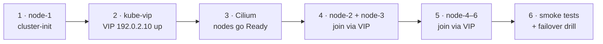

# 04 — Cluster Build (Phase 2)

> **Status (2026-09-25):** design intent, written as the 2026-07 build plan. [AS-BUILT.md](AS-BUILT.md) is authoritative for what is running ([README](README.md)).

Six baselined VMs → an HA Kubernetes cluster with Cilium and a VIP.
Order matters: **node-1 → kube-vip → Cilium → node-2/3 → workers**.
Versions: [03 § version pins](03-provisioning.md#version-pins).

Live copies of the configs below are in [`live/`](live/README.md)
(`server-init.yaml`, `server-join.yaml`, `agent.yaml`, `kube-vip-ds.yaml`,
`cilium-lb-pool.yaml`).

> **Addresses.** The cluster uses API VIP `192.0.2.10` and LB pool
> `192.0.2.200–220` (network plan in [01-architecture.md](01-architecture.md)).
> An earlier revision of this doc kept printing stale values in its
> copy-paste blocks after the build had moved on; the values here are
> cross-checked against
> [`ansible/roles/cilium/defaults/main.yml`](../ansible/roles/cilium/defaults/main.yml)
> and the gitops repository's LB-pool manifest.
>
> **Version.** The install commands below show `v1.34.4+k3s1`, the version
> of the July 2026 build. Rebuilds now go through the `k3s_node` Ansible role,
> which installs the version pinned in
> [`ansible/roles/k3s_node/defaults/main.yml`](../ansible/roles/k3s_node/defaults/main.yml).



## 1 — node-1 (bootstrap server)

`/etc/rancher/k3s/config.yaml` on **node-1**:

```yaml
cluster-init: true
token: <k3s join token, kept outside the repo>
tls-san:
  - 192.0.2.10          # the VIP — must be in the API cert
node-taint:
  - node-role.kubernetes.io/control-plane:NoSchedule
disable:
  - traefik                # replaced by ingress-nginx (Phase 3)
  - servicelb              # replaced by Cilium LB-IPAM
  - local-storage          # replaced by Longhorn
flannel-backend: none      # Cilium is the CNI
disable-network-policy: true
disable-kube-proxy: true   # Cilium kube-proxy replacement
secrets-encryption: true
etcd-snapshot-schedule-cron: "0 3 * * *"
etcd-snapshot-retention: 14
kube-apiserver-arg:
  - audit-log-path=/var/lib/rancher/k3s/server/logs/audit.log
  - audit-log-maxage=7
node-label:
  - topology.kubernetes.io/zone=pve-1
```

Install (pinned):

```bash
curl -sfL https://get.k3s.io | INSTALL_K3S_VERSION="v1.34.4+k3s1" sh -s - server
```

Expected state: k3s active, **node NotReady** — normal until Cilium lands.
`kubectl get nodes` works on the box via `sudo k3s kubectl`.

## 2 — kube-vip

On node-1, drop manifests into the auto-deploy dir
(`/var/lib/rancher/k3s/server/manifests/` — k3s applies anything here):

```bash
# RBAC (upstream-provided)
sudo curl -sL https://kube-vip.io/manifests/rbac.yaml \
  -o /var/lib/rancher/k3s/server/manifests/kube-vip-rbac.yaml

# DaemonSet — generated by the kube-vip container itself
export VIP=192.0.2.10 KVVERSION=v0.9.2 INTERFACE=eth0
sudo ctr image pull ghcr.io/kube-vip/kube-vip:$KVVERSION
sudo ctr run --rm --net-host ghcr.io/kube-vip/kube-vip:$KVVERSION vip \
  /kube-vip manifest daemonset \
    --interface $INTERFACE --address $VIP \
    --inCluster --taint --controlplane \
    --arp --leaderElection \
  | sudo tee /var/lib/rancher/k3s/server/manifests/kube-vip-ds.yaml >/dev/null
```

Verify from the admin workstation: `ping 192.0.2.10` answers. (The DaemonSet is
hostNetwork and tolerates NotReady nodes, so it runs before the CNI.)

## 3 — Cilium

From the admin workstation (or node-1) with a kubeconfig pointing at
`https://192.0.2.11:6443` for now:

```bash
helm repo add cilium https://helm.cilium.io && helm repo update
helm install cilium cilium/cilium --version 1.17.5 -n kube-system \
  -f cilium-values.yaml
```

> **Superseded 2026-07-28: the values that used to be here are gone on purpose.**
> The canonical Cilium values are
> [`ansible/roles/cilium/defaults/main.yml`](../ansible/roles/cilium/defaults/main.yml),
> and [`scripts/verify-cilium-values.sh`](../scripts/verify-cilium-values.sh)
> proves they match the live release. Production's Cilium is installed by that
> role through k3s's HelmChart controller; see
> [docs/runbooks/cilium-adoption.md](../docs/runbooks/cilium-adoption.md).
>
> The old block was wrong in three ways, and it read as the record of a working
> cluster for three weeks:
>
> | It said | The cluster actually ran |
> |---|---|
> > | `operator.replicas: 2` | `1` |
> | `ipam.mode: kubernetes` | `cluster-pool`, with `clusterPoolIPv4MaskSize: 24` |
> | *(absent)* | `k8sClientRateLimit: {qps: 50, burst: 100}` |
>
> The last row was the dangerous one: adopting from a role built to match this
> doc would have silently reset the CNI's API client to chart defaults across
> six nodes. It was caught by diffing against `helm get values` instead of
> reading, and that diff is now a script, run before any change to this
> component.
>
> The original plan, "canonical values live in the gitops repo once ArgoCD
> adopts Cilium", was also **rejected**: ArgoCD cannot install the network it
> needs in order to run, so a rebuilt node would have no CNI and nothing able
> to give it one.

Then the LB pool + announcement policy. **These two are ArgoCD-owned**: the
gitops repository's `clusters/homelab/config/cilium-lb-pool.yaml` is the
source of truth and the block below is a reference copy of it. Unlike the Cilium release itself,
these are ordinary CRs and ArgoCD can perfectly well own them; only the CNI
install has the bootstrap problem described above.

Reproduced here for a cold rebuild, when there is no ArgoCD yet:

```yaml
apiVersion: cilium.io/v2alpha1
kind: CiliumLoadBalancerIPPool
metadata: { name: homelab-v2-pool }
spec:
  # ingress-nginx is pinned to 192.0.2.200, the first address in the pool.
  blocks: [{ start: 192.0.2.200, stop: 192.0.2.220 }]
---
apiVersion: cilium.io/v2alpha1
kind: CiliumL2AnnouncementPolicy
metadata: { name: homelab-v2-l2 }
spec:
  nodeSelector:
    matchExpressions:
      - { key: node-role.kubernetes.io/control-plane, operator: DoesNotExist }
  interfaces: [eth0]
  loadBalancerIPs: true
```

Wait for `node-1` to go **Ready**.

## 4 — node-2 and node-3

Same `config.yaml` as node-1 **except**: drop `cluster-init`, add
`server:`, fix the zone label:

```yaml
server: https://192.0.2.10:6443     # join via the VIP
token: <same token>
tls-san: [192.0.2.10]
node-taint: [node-role.kubernetes.io/control-plane:NoSchedule]
disable: [traefik, servicelb, local-storage]
flannel-backend: none
disable-network-policy: true
disable-kube-proxy: true
secrets-encryption: true
etcd-snapshot-schedule-cron: "0 3 * * *"
etcd-snapshot-retention: 14
node-label:
  - topology.kubernetes.io/zone=pve-2   # node-3: pve-3
```

```bash
curl -sfL https://get.k3s.io | INSTALL_K3S_VERSION="v1.34.4+k3s1" sh -s - server
```

One at a time; wait for each to appear Ready before the next.

## 5 — node-4/5/6 (agents)

`/etc/rancher/k3s/config.yaml`:

```yaml
server: https://192.0.2.10:6443
token: <same token>
node-label:
  - topology.kubernetes.io/zone=pve-1   # node-5: pve-2 · node-6: pve-3
  # node-6 only, additionally:
  # - node-role/tier=light
```

```bash
curl -sfL https://get.k3s.io | INSTALL_K3S_VERSION="v1.34.4+k3s1" sh -s - agent
```

## 6 — Kubeconfig for the admin workstation

```bash
ssh kube@192.0.2.11 'sudo cat /etc/rancher/k3s/k3s.yaml' \
  | sed 's/127.0.0.1/192.0.2.10/' \
  | sed 's/default/homelab-v2/g' > ~/.kube/homelab-v2.yaml
export KUBECONFIG=~/.kube/config:~/.kube/homelab-v2.yaml
kubectl config use-context homelab-v2
```

> **Always the VIP IP, never a hostname**: `k3s.lab.example.com` would
> resolve to NPM because of the split-DNS wildcard redirect
> ([06 § gotchas](06-operations.md#gotchas)).

## Smoke Tests (Phase 2 gate)

```bash
kubectl get nodes -o wide          # 6 Ready; correct IPs, zones, taints
kubectl -n kube-system exec ds/cilium -- cilium-dbg status --brief   # OK
cilium connectivity test           # full e2e suite (takes ~10 min)
ssh kube@192.0.2.11 'sudo k3s etcd-snapshot ls'                   # snapshots listing works
kubectl get ciliumloadbalancerippools                                 # pool present
```

**Failover drill (mandatory before Phase 3):**

1. `watch kubectl get nodes` from the admin workstation (via the VIP).
2. Hard-stop both VMs on pve-2: `ssh root@192.0.2.5 'qm stop 502 505'`.
3. Expect: watch keeps updating (VIP moved if node-2 held it — a few
   seconds' blip is OK); node-2/node-5 go NotReady; test pods
   reschedule after ~5 min (default eviction).
4. `qm start 502 505`, confirm both rejoin Ready and etcd shows 3 healthy
   members: `kubectl -n kube-system get pods -l component=etcd` /
   `sudo k3s etcd-snapshot ls` still works.

Record results in [07-testing.md § drill log](07-testing.md#drill-log).

## Teardown / Rebuild

Full reset of one node: for a **worker**, use
[`docs/runbooks/node-rebuild.md`](../docs/runbooks/node-rebuild.md), the
procedure as actually executed against production node-4 on 2026-07-28 via
`tofu apply -replace` + `ansible/playbooks/k3s-node.yml`. For a control plane,
which has not been rebuilt from code, the sketch is
[06 § W6 node replacement](06-operations.md#w6--replace-a-dead-node).
Full cluster reset: destroy all six, re-run Phases 1–2: under an hour
when the docs are followed cold. That number is the point of this folder.
