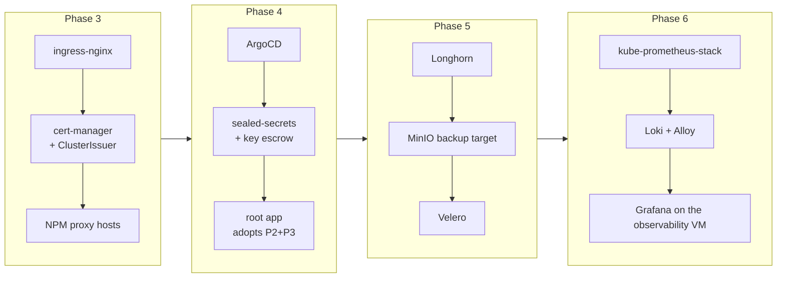

# 05 — Platform Services (Phases 3–6)

> **Status (2026-09-25):** design intent, written as the 2026-07 build plan. [AS-BUILT.md](AS-BUILT.md) records what was running at its July 2026 snapshot ([README](README.md)).

Everything between "Kubernetes works" and "apps can live here."
After Phase 4, **ArgoCD owns all of this**: the values files below are
reference copies, and the canonical versions live in the gitops repository
(`clusters/homelab/`). Live copies of most values files are also in
[`live/`](live/README.md).



## GitOps Repo Layout

```
clusters/homelab/                # in the gitops repository
├── bootstrap/
│   └── root-app.yaml            # the ONE manifest applied by hand
├── infra/                       # sync-wave -1 … 0
│   ├── kube-vip/
│   ├── ingress-nginx/
│   ├── cert-manager/
│   ├── sealed-secrets/
│   ├── longhorn/
│   ├── velero/
│   ├── monitoring/              # kube-prometheus-stack, loki, alloy
│   └── system-upgrade/          # controller + upgrade Plans
└── apps/                        # sync-wave 1+
    ├── whoami/                  # the canary
    └── …                        # migrated v1 apps, one dir each
```

Each `infra/<name>/` is an ArgoCD `Application` (Helm chart + values, or
plain manifests). `root-app.yaml` is an Application pointing at both
`infra/` and `apps/`: the app-of-apps. Repo URL: the Forgejo clone URL
(an optional GitHub mirror is deferred, so the repo credential is
Forgejo-only).

One exception to "ArgoCD owns it": the Cilium release itself is installed by
Ansible, not ArgoCD, because ArgoCD cannot install the network it needs to
run ([04 § 3](04-cluster-build.md#3--cilium)). ArgoCD owns only Cilium's LB
pool and L2 announcement CRs.

## Phase 3 — Ingress + Certificates

### ingress-nginx

```yaml
# infra/ingress-nginx/values.yaml
controller:
  replicaCount: 2
  service:
    annotations:
      lbipam.cilium.io/ips: "192.0.2.200"   # pin the LB IP
    type: LoadBalancer
  ingressClassResource: { default: true }
  metrics:
    enabled: true
    serviceMonitor: { enabled: true }           # picked up in Phase 6
  topologySpreadConstraints:
    - maxSkew: 1
      topologyKey: topology.kubernetes.io/zone
      whenUnsatisfiable: ScheduleAnyway
      labelSelector: { matchLabels: { app.kubernetes.io/name: ingress-nginx } }
```

### cert-manager

Install with `installCRDs: true`, then:

```yaml
apiVersion: cert-manager.io/v1
kind: ClusterIssuer
metadata: { name: letsencrypt-dns }
spec:
  acme:
    server: https://acme-v02.api.letsencrypt.org/directory
    email: ops@example.com
    privateKeySecretRef: { name: letsencrypt-dns-key }
    solvers:
      - dns01:
          cloudflare:
            apiTokenSecretRef: { name: cloudflare-api-token, key: token }
---
apiVersion: cert-manager.io/v1
kind: Certificate
metadata: { name: wildcard-apps, namespace: ingress-nginx }
spec:
  secretName: wildcard-apps-tls
  issuerRef: { name: letsencrypt-dns, kind: ClusterIssuer }
  dnsNames: ["*.apps.example.com", "lab.example.com"]
```

The Cloudflare token Secret is the first **sealed** secret once Phase 4
lands; until then create it by hand and don't commit it.

**TLS model** (see [09-traffic-flows](09-traffic-flows.md)): LAN/tunnel
traffic terminates TLS at NPM (its existing wildcard certificate) and
reaches ingress-nginx as HTTP with the original Host header; the in-cluster
wildcard covers direct-to-`192.0.2.200` HTTPS and future in-cluster needs.

### NPM wiring

For each cluster hostname: NPM proxy host `foo.apps.example.com` →
`http://192.0.2.200:80`, websockets on, reusing NPM's wildcard certificate.
Split DNS already resolves everything to NPM, so there is **no DNS work per
app**.

**Gate:** `https://whoami.apps.example.com` green-locked from the LAN.

## Phase 4 — ArgoCD + sealed-secrets

### ArgoCD

```yaml
# infra/argocd/values.yaml (chart: argo-cd)
configs:
  params:
    server.insecure: true          # TLS terminates at NPM/ingress
global: { domain: argocd.apps.example.com }
server:
  ingress:
    enabled: true
    ingressClassName: nginx
    hostname: argocd.apps.example.com
```

Bootstrap sequence (the only hand-applied steps in the cluster's life):

```bash
helm install argo-cd argo/argo-cd -n argocd --create-namespace -f values.yaml
kubectl -n argocd get secret argocd-initial-admin-secret -o jsonpath='{.data.password}' | base64 -d
# → change password, store it in the password manager, delete the initial secret
argocd repo add <forgejo-clone-url> --username <user> --password <token>
kubectl apply -f bootstrap/root-app.yaml
```

From here on: **all changes via git commit**, never `kubectl apply`.

### sealed-secrets

```bash
helm install sealed-secrets sealed-secrets/sealed-secrets -n kube-system
# ESCROW THE KEY — IMMEDIATELY, NON-NEGOTIABLE:
kubectl -n kube-system get secret -l sealedsecrets.bitnami.com/sealed-secrets-key \
  -o yaml > sealed-secrets-key-$(date +%F).yaml
# → store outside the repo AND on the TrueNAS backup dataset. Never commit.
```

Workflow for creating/rotating secrets: [06 § W2](06-operations.md#w2--add-or-rotate-a-secret).

**Gate:** root app Synced/Healthy; hand-deleting the whoami Deployment
gets self-healed within a minute.

## Phase 5 — Storage + Backups

### Longhorn

```yaml
# infra/longhorn/values.yaml
defaultSettings:
  defaultDataPath: /var/lib/longhorn
  defaultReplicaCount: 3
  replicaZoneSoftAntiAffinity: false     # hard spread: one replica per physical host
  backupTarget: s3://lab-backups@us-east-1/longhorn
  backupTargetCredentialSecret: minio-credentials
  systemManagedComponentsNodeSelector: ""
longhornUI: {}   # exposed via ingress longhorn.apps.example.com (basic-auth annotation)
```

Extra StorageClass for less-critical bulk on replicated storage:

```yaml
apiVersion: storage.k8s.io/v1
kind: StorageClass
metadata: { name: longhorn-2r }
provisioner: driver.longhorn.io
parameters: { numberOfReplicas: "2", staleReplicaTimeout: "2880" }
allowVolumeExpansion: true
```

Recurring jobs (as `RecurringJob` CRs in git): daily snapshot (retain 7),
weekly backup to MinIO (retain 4), default group so new volumes inherit.

### NFS bulk class

nfs-subdir-external-provisioner → `198.51.100.50:/mnt/tank/k3s-nfs`
(dataset created on TrueNAS), class `nfs-bulk`, `reclaimPolicy: Retain`.

### Velero

```yaml
# infra/velero/values.yaml
credentials:
  existingSecret: minio-credentials
configuration:
  backupStorageLocation:
    - name: default
      provider: aws
      bucket: lab-backups
      prefix: velero
      config: { region: us-east-1, s3ForcePathStyle: "true", s3Url: "https://s3.example.com" }
  volumeSnapshotLocation: []        # volumes are Longhorn's job, not Velero's
initContainers:
  - name: velero-plugin-for-aws
    image: velero/velero-plugin-for-aws:v1.12.0
    volumeMounts: [{ mountPath: /target, name: plugins }]
schedules:
  daily-cluster:
    schedule: "0 2 * * *"
    template: { includedNamespaces: ["*"], snapshotVolumes: false, ttl: 720h }
```

### etcd snapshots off-node

Add to every control node's `config.yaml` (via Ansible template + rolling
restart, [06 § W5](06-operations.md#w5--drain-a-node--host-maintenance)):

```yaml
etcd-s3: true
etcd-s3-endpoint: s3.example.com
etcd-s3-bucket: lab-backups
etcd-s3-folder: etcd
etcd-s3-insecure: true
etcd-s3-access-key: <MinIO access key>
etcd-s3-secret-key: <MinIO secret key>
```

**Gate:** a restore drill ([08 § R1](08-backup-dr.md#r1--restore-a-single-pvc)):
back up a PVC with data, delete it, restore it, diff the data.

## Phase 6 — Observability

### kube-prometheus-stack

```yaml
# infra/monitoring/kps-values.yaml
grafana: { enabled: false }                  # the observability VM's Grafana is the pane of glass
prometheus:
  prometheusSpec:
    retention: 15d
    storageSpec:
      volumeClaimTemplate:
        spec: { storageClassName: longhorn, resources: { requests: { storage: 30Gi } } }
    serviceMonitorSelectorNilUsesHelmValues: false   # scrape everything labeled
alertmanager:
  config:
    route: { receiver: default }
    receivers: [{ name: default }]           # wire to the lab's channel at build time
```

Expose Prometheus + Alertmanager via ingress (`prom-k3s.lab.example.com`,
`alerts-k3s.lab.example.com`) with a basic-auth annotation.

### Loki + Alloy

Loki single-binary, 20Gi Longhorn PVC, 14-day retention; Alloy DaemonSet
shipping all pod logs + journal. Both as `infra/monitoring/` apps.

### Grafana on the observability VM

Add datasources to the observability VM's Grafana (provisioned as YAML in
that VM's configuration): Prometheus →
`https://prom-k3s.lab.example.com`, Loki → `https://loki-k3s.lab.example.com`.
Import/provision dashboards: cluster overview (15757), node-exporter
(1860), Longhorn (13032), Cilium/Hubble, ArgoCD (14584), as provisioned
JSON files.

### Baseline alerts (severity: `critical` / `warning` / `info`)

| Alert | Severity | Condition |
|---|---|---|
| NodeDown | critical | node NotReady > 5m |
| EtcdNoLeader / member down | critical | etcd insufficient members |
| LonghornVolumeDegraded | warning | replica count below spec > 10m |
| PVCAlmostFull | warning | > 85% |
| CertExpiringSoon | warning | < 14 days |
| VeleroBackupFailed | warning | last schedule failed |
| ArgoAppOutOfSync | info | > 1h |

### External witness

Uptime Kuma on the observability VM monitors: VIP :6443 (TCP), `https://whoami.apps.example.com`,
ArgoCD, Longhorn UI, MinIO :9000. These page even when in-cluster
monitoring is what died.

**Gate:** cluster metrics + logs visible in the observability Grafana; stopping a worker
VM fires NodeDown within 5 minutes.
