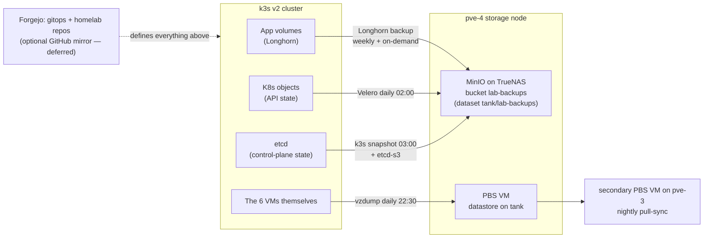

# 08 — Backups & Disaster Recovery

> **Status (2026-09-25):** current as the incident procedure; written for the 2026-07 build — [AS-BUILT.md](AS-BUILT.md) records what was running at its July 2026 snapshot ([README](README.md)).

Four independent layers, each restoring a different class of failure, all
landing **outside the cluster** (MinIO/PBS on the pve-4 storage node). This
doc is written to be followed during an incident: scenarios R1–R6 below
are ordered from routine to catastrophic.

The lab-wide backup posture is documented separately; this cluster adds the
rows below to it.

## The Four Layers



| Layer | Tool | What it protects | Schedule | Retention | Restores |
|---|---|---|---|---|---|
| 1 Volumes | Longhorn → MinIO | app data (PVCs) | snapshot daily / backup weekly + pre-change | 7 snaps / 4 backups | one PVC, one file (via mount) |
| 2 Objects | Velero → MinIO | namespaces, CRDs, RBAC, everything `kubectl get` | daily 02:00 | 30 days | a namespace, a resource, cluster object state |
| 3 etcd | k3s snapshots → local + MinIO | control-plane state as a unit | daily 03:00 | 14 | quorum loss, botched upgrade |
| 4 VM images | PBS (primary → secondary sync) | whole VMs incl. OS | daily 22:30 | per PBS policy | "the VM won't boot" |
| 0 Git | Forgejo (+ deferred GitHub mirror) | the *definitions* of everything | on push | — | everything stateless |

**Design rule:** Git + layer 1 restores any app. Git + layer 3 restores
the control plane. Layers 2 and 4 are accelerators and second chances —
never the only copy of anything.

## RPO / RTO Targets

Honest homelab numbers, verified by drills ([07-testing.md](07-testing.md)):

| Scenario | RPO (max data loss) | RTO (target time to restore) |
|---|---|---|
| R1 single PVC | 24h (last snapshot) / 0 if pre-change backup taken | 15 min |
| R2 namespace wrecked | 24h | 30 min |
| R3 node lost | 0 (replicas live) | 30 min (W6), 0 for service continuity |
| R4 full cluster rebuild | 24h worst case | half a day |
| R5 etcd quorum loss | ≤ 24h (last snapshot; usually 0 — data volumes unaffected) | 1–2h |
| R6 pve-4 lost (backup target itself) | no cluster impact; backup *capability* down | rebuild pve-4 per its own docs |

## Restore Procedures

### R1 — Restore a single PVC

*When: bad deploy corrupted data, fat-fingered delete inside an app.*

1. Scale the app down: `kubectl scale deploy/<app> -n <ns> --replicas=0`.
2. Longhorn UI → **Backup** → select the volume's backup → *Restore
   Latest* (new volume name, e.g. `<vol>-restore`).
3. Create a PV/PVC from the restored volume (Longhorn UI offers
   *Create PV/PVC*), or for in-place: delete the broken PVC, restore
   under the original name.
4. Point the app at the claim (git change if the claim name changed),
   scale up, verify app-level data.

*File-level alternative:* restore to a new volume, mount it in a utility
pod alongside the live PVC, copy the files across, discard the restore.

### R2 — Restore a namespace's objects

*When: someone deleted a namespace or mangled resources; data volumes intact or handled via R1.*

```bash
velero backup get                                   # pick the last good daily
velero restore create --from-backup <name> --include-namespaces <ns>
velero restore describe <restore-name>              # wait for Completed
kubectl get all -n <ns>
```

Velero doesn't restore over existing resources — delete broken ones first
or restore into a scratch namespace (`--namespace-mappings src:dst`) to
cherry-pick.

### R3 — Node lost

[06 § W6](06-operations.md#w6--replace-a-dead-node). Storage/quorum
context: one worker gone = volumes degraded but serving (2/3 replicas);
one control gone = quorum fine (2/3). No restore needed — rebuild the
node, replicas/members resync automatically.

### R4 — Full cluster rebuild from Git

*When: cluster unrecoverable but hosts fine — or hosts rebuilt too. The
"prove GitOps is real" path; also drill C5.*

1. Phases 1–2: tofu + ansible + k3s + kube-vip + Cilium
   ([03](03-provisioning.md), [04](04-cluster-build.md)).
2. Install ArgoCD (05 § Phase 4 bootstrap), add the Forgejo repo cred.
   *(If Forgejo itself died with the cluster, restore it standalone
   first: R1 its volume from MinIO into a temp docker host, or use the
   GitHub mirror once the operator adds it.)*
3. **Restore the sealed-secrets key BEFORE the root app** — otherwise
   every SealedSecret fails to unseal:

   ```bash
   kubectl apply -f sealed-secrets-key-<date>.yaml   # from escrow
   kubectl -n kube-system rollout restart deploy sealed-secrets
   ```

4. Apply `bootstrap/root-app.yaml`; ArgoCD converges the platform.
5. Longhorn: same backup target settings → **Backup** list appears →
   restore app volumes (R1) before/as apps scale up.
6. `cluster-health.sh` green; drill log entry with total wall time.

### R5 — etcd quorum loss

*When: two+ control nodes dead simultaneously. API is read-only or down;
apps generally keep running (kubelets/pods don't need the API to serve).*

1. Don't panic-restart things: workloads are still serving. Pick the
   healthiest surviving control node (or the first rebuilt one).
2. On it, reset the cluster to a one-member etcd from the latest snapshot:

   ```bash
   sudo systemctl stop k3s
   sudo k3s server --cluster-reset \
     --cluster-reset-restore-path=<snapshot>   # local path or s3 snapshot name
   # follow the printed instruction, then:
   sudo systemctl start k3s
   ```

   (Snapshots: local `/var/lib/rancher/k3s/server/db/snapshots/` or
   `sudo k3s etcd-snapshot ls` for the S3 copies.)
3. On the **other two** control nodes: `sudo systemctl stop k3s` and
   `sudo rm -rf /var/lib/rancher/k3s/server/db` — they must rejoin fresh,
   then `sudo systemctl start k3s` (config still points at the VIP).
4. Verify: 3 controls Ready, `kubectl get nodes`, ArgoCD shows drift
   between snapshot-time state and git → sync reconciles it. Longhorn
   volumes reattach.

### R6 — Backup target (pve-4) lost

Cluster keeps running; Longhorn/Velero/etcd-s3 jobs start failing
(→ `VeleroBackupFailed` / job alerts). Priorities: (1) recover pve-4 per its
own host runbook, (2) the secondary PBS VM on pve-3 holds the second copy of
VM images, (3) take a manual etcd snapshot + Velero
backup to local/alternate storage if pve-4 will be down for days.

## Backup Verification (scheduled)

| Cadence | Check |
|---|---|
| Weekly (with cluster-health.sh) | last Velero backup Completed; last Longhorn backup job succeeded; newest etcd snapshot < 26h old in MinIO |
| Monthly | R1 drill on a test volume (backup → delete → restore → diff) |
| Quarterly | R2 into a scratch namespace + chaos drill (07 § C1–C4) |
| Annually | R4/C5 full game day |

**A backup that has never been restored is a hope, not a backup.** The
escrowed sealed-secrets key is part of every backup review: confirm it
exists in its escrow outside the repository *and* on TrueNAS, and matches the running
controller (`kubeseal --fetch-cert` unchanged).
