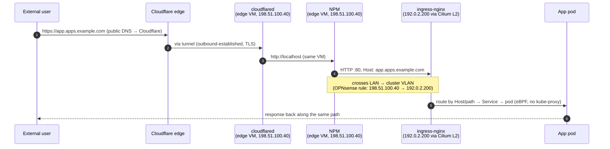
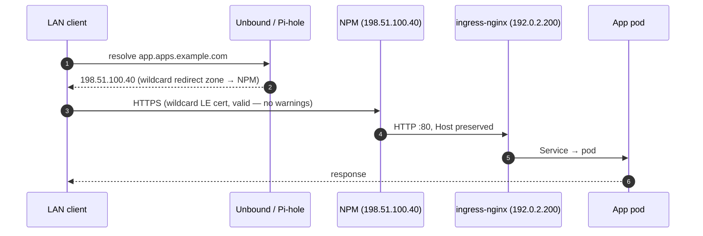
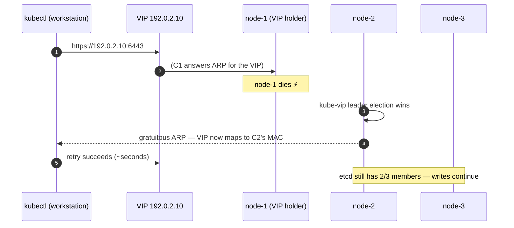
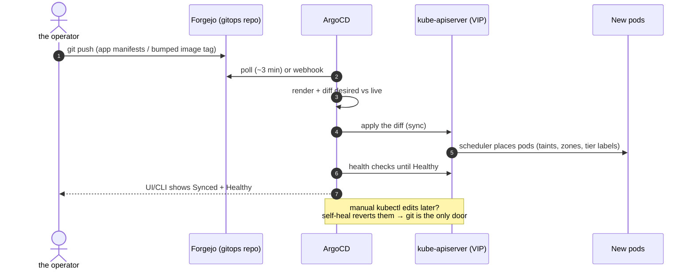
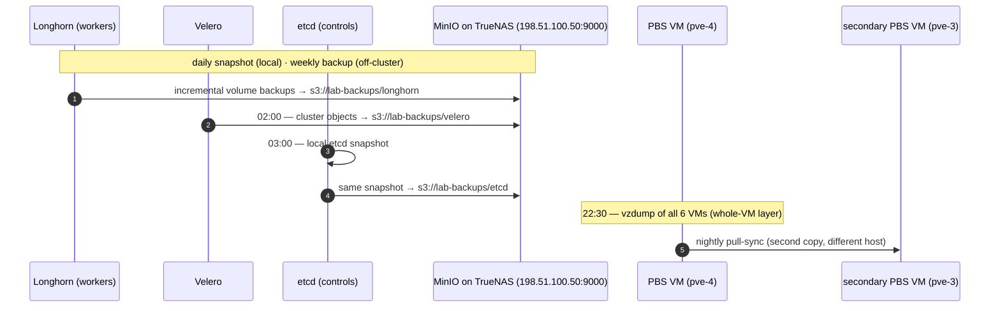
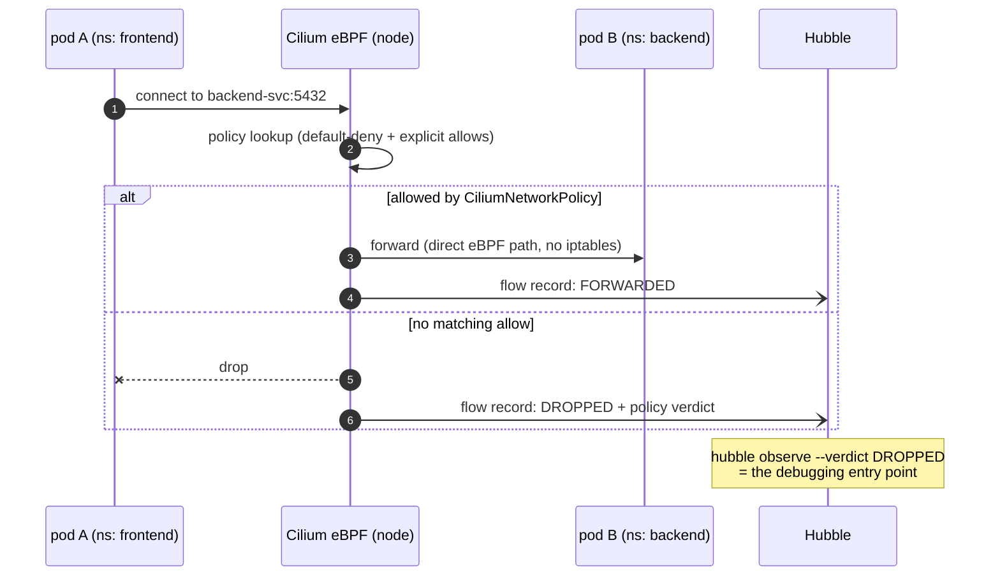

# 09 — Traffic & Workflow Flows

> **Status (2026-09-25):** design intent, written for the 2026-07 build — [AS-BUILT.md](AS-BUILT.md) is authoritative for what is running ([README](README.md)).

Sequence diagrams for every interesting path: request traffic, control
traffic, GitOps, certificates, backups. Companion to the static topology
in [01-architecture.md](01-architecture.md). Addresses: API VIP
`192.0.2.10`, ingress-nginx `192.0.2.200`.

## F1 — External User (Internet → app)

No WAN port-forwards exist; the **only** way in is the Cloudflare tunnel.



TLS terminates twice by design: Cloudflare edge (public cert) and
NPM (wildcard cert id 2). Inside the lab, NPM→ingress is HTTP with the
Host header preserved — one place (NPM) owns the lab's TLS posture.

## F2 — Internal User (LAN → app, split DNS)



Consequence of the wildcard redirect: **every** `*.apps.example.com` name goes
to NPM — including `k3s.lab.example.com`. That's why kubeconfigs use the VIP
IP, and why new apps need an NPM proxy host but **zero DNS changes**.

## F3 — Kubernetes API HA (kube-vip failover)



## F4 — GitOps Deploy (commit → running pod)



## F5 — Certificate Issuance (DNS-01, no inbound traffic)

```mermaid
sequenceDiagram
    autonumber
    participant CM as cert-manager
    participant LE as Let's Encrypt
    participant CF as Cloudflare DNS API
    participant S as Secret (wildcard TLS)

    CM->>LE: order *.apps.example.com
    LE-->>CM: DNS-01 challenge token
    CM->>CF: create TXT _acme-challenge.apps.example.com (API token, sealed secret)
    LE->>CF: query TXT record — matches
    LE-->>CM: certificate issued
    CM->>S: store cert+key; renew automatically at 2/3 lifetime
    CM->>CF: clean up TXT record
```

Works with zero inbound connectivity — the whole reason DNS-01 is the
only viable ACME method behind double NAT.

## F6 — Backup Flows (nightly)



All four layers land on hardware **outside the cluster** (pve-4), and the VM
layer gets a second copy on a second host (pve-3). Restore paths:
[08-backup-dr.md](08-backup-dr.md).

## F7 — Pod-to-Pod with NetworkPolicy (Phase 8 posture)



Every namespace ships a default-deny plus explicit allows for: its own
traffic, DNS (kube-dns), ingress-nginx (if exposed), and Prometheus
scraping. The Hubble verdict log is what makes this posture *operable*
rather than a foot-gun.
