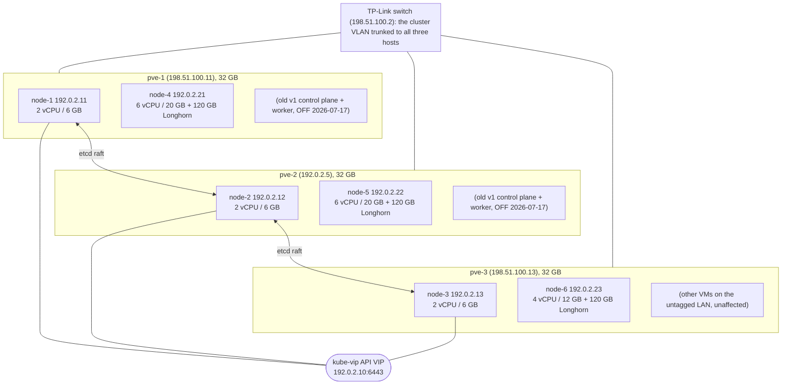
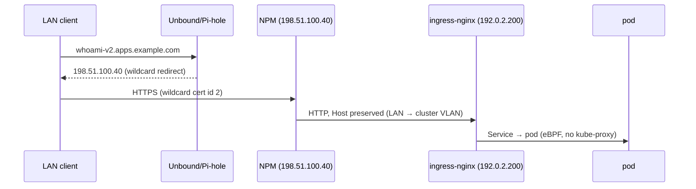

# k3s v2 — As-Built System Document

**Dated snapshot:** first written 2026-07-06, updated through 2026-07-24. It
records what was running at those dates and is not maintained as live state.
**Status at the snapshot:** full 3+3 cluster live and healthy.
**Scope:** what was *actually running*, as opposed to the target design in
[ADR 0008](../docs/adr/0008-k3s-v2-enterprise-rebuild.md) and docs
[01–09](README.md). The numbered docs remain the design intent. For the k3s
version a rebuild installs today, see the pin in
[`ansible/roles/k3s_node/defaults/main.yml`](../ansible/roles/k3s_node/defaults/main.yml).

---

## 1. Executive summary

A **full 6-node (3+3) k3s v2 cluster is live** across all three Proxmox hosts
(pve-1, pve-2, pve-3) and validated end-to-end: HA control plane with real
3-node etcd quorum, Cilium networking with kube-proxy replacement, a load
balancer, ingress, automatic TLS, and 3-replica distributed block storage. It
was built **alongside the untouched, still-serving v1 cluster**, which was
powered off (kept, not deleted) on 2026-07-17. A **pve-2 hard-off
failover drill passed** — the API stayed available on the VIP with a
control-plane node (the VIP leader) down.

Higher layers (GitOps, off-cluster backups, observability, workload migration)
were initially blocked for the concrete reasons recorded in §8; all of them
have since landed (§12).

| Layer | State | Notes |
|-------|-------|-------|
| Provisioning (OpenTofu + Ansible) | ✅ done | `tofu/k3s/` (6 VMs), `ansible/…/k3s-v2-baseline.yml` |
| k3s HA core + etcd | ✅ done | **3 control planes (etcd quorum)**, v1.34.4+k3s1 |
| kube-vip API VIP + failover drill | ✅ done | 192.0.2.10 (ARP); pve-2 hard-off survived |
| Cilium CNI + kube-proxy replacement | ✅ done | 1.17.5, Hubble, LB-IPAM + L2 |
| ingress-nginx | ✅ done | pinned 192.0.2.200 |
| cert-manager (DNS-01) | ✅ done | wildcard `*.k8s.lab.example.com` issued |
| External path via NPM | ✅ done | `whoami-v2.apps.example.com` → HTTPS 200 |
| Longhorn storage | ✅ done | **3 replicas**, one per zone; drills passed |
| 3rd control plane + worker (pve-3) | ✅ done | The cluster VLAN trunked to pve-3 2026-07-06 |
| GitOps (ArgoCD + sealed-secrets) | ✅ done | app-of-apps from Forgejo; key escrowed; old Forgejo was flaky (§8.2) |
| Observability (metrics) | ✅ done | kube-prometheus-stack; Grafana `grafana-k3s.lab.example.com` |
| Off-cluster backups (4 layers) | ✅ done | MinIO on TrueNAS; Longhorn+Velero+etcd-s3+PBS; **R1 drill passed** |
| Observability (logs) | ✅ done | Loki + Alloy on all nodes; **NodeDown alert gate 221s**; Kuma monitors UP |
| Workload migration (Forgejo → v2) | ✅ done | Forgejo migrated to v2 on `:14.0.5`, 2026-07-17 |
| Old-cluster archive (stop, never delete) | ✅ done | v1 powered off 2026-07-17; kept for reference, not deleted |

---

## 2. Physical & virtual topology (as built)



- **etcd quorum = 2 of 3** → tolerates **one** control-plane / physical-host
  loss (validated by the pve-2 hard-off drill: API stayed up on the VIP with
  node-2 — the VIP leader — down).
- **Zones** (`topology.kubernetes.io/zone`): node-1/node-4 = `pve-1`,
  node-2/node-5 = `pve-2`, node-3/node-6 = `pve-3`. Longhorn 3-replica
  volumes and workloads spread across all three failure domains.

---

## 3. Node inventory (live)

| Node | IP | VMID | Host | Role | vCPU | RAM | Disks |
|------|----|----|----|----|----|----|----|
| node-1 | 192.0.2.11 | 501 | pve-1 | control-plane, etcd | 2 | 6 GB | 60 GB |
| node-2 | 192.0.2.12 | 502 | pve-2 | control-plane, etcd | 2 | 6 GB | 60 GB |
| node-3 | 192.0.2.13 | 503 | pve-3 | control-plane, etcd | 2 | 6 GB | 60 GB |
| node-4 | 192.0.2.21 | 504 | pve-1 | worker | 6 | 20 GB | 80 GB + 120 GB Longhorn |
| node-5 | 192.0.2.22 | 505 | pve-2 | worker | 6 | 20 GB | 80 GB + 120 GB Longhorn |
| node-6 | 192.0.2.23 | 506 | pve-3 | worker | 4 | 12 GB | 80 GB + 120 GB Longhorn |

OS: Ubuntu 24.04, cloned from per-host templates (900 on pve-1, 901 on pve-2,
**902 on pve-3**). SSH `kube` (key auth, passwordless sudo). Guest agent installed.

> **RAM restored 2026-07-24 (ADR 0010):** v1 is off, so node-4/node-5 grew
> to 6 vCPU / 20 GB (equalized on pve-1/pve-2, `tier=heavy`). node-6 on pve-3
> stays 4 vCPU / 12 GB and is tainted `workload-tier=light:PreferNoSchedule`
> (pve-3 shares the host with other lab VMs). **Still reduced vs the ADR 0008
> spec:** Longhorn data disks are 120 GB (target 350 GB), tracked separately.

---

## 4. Network (cluster VLAN, 192.0.2.0/24)

| Range / IP (192.0.2.x) | Owner | Purpose |
|-----------|-------|---------|
| `.1` | OPNsense | cluster VLAN gateway |
| `.5` | pve-2 | Proxmox management |
| **`.10`** | **kube-vip** | **API VIP** (kubeconfig target — always the IP) |
| `.11–.13` | control plane | node-1, node-2, node-3 (node-3 on pve-3) |
| `.21–.23` | workers | node-4, node-5, node-6 (node-6 on pve-3) |
| **`.200–.220`** | **Cilium LB-IPAM** | LoadBalancer IPs (`.200` = ingress-nginx) |

**DNS / ingress model (unchanged from v1):** public `*.apps.example.com` is
unreachable from the LAN (double NAT, no port-forwards). Split-DNS points
`*.apps.example.com` at **NPM on the edge VM (198.51.100.40)**, which terminates
TLS with a wildcard cert (id 2) and proxies **HTTP** to the cluster ingress
with the Host header preserved. New cluster apps therefore need **an NPM
proxy host, no DNS change**. The kubeconfig must use the VIP **IP** — the
hostname `k3s.lab.example.com` would resolve to NPM.



---

## 5. Component inventory (versions as installed)

| Component | Version | How installed | Namespace |
|-----------|---------|---------------|-----------|
| k3s | v1.34.4+k3s1 | `get.k3s.io` + `/etc/rancher/k3s/config.yaml` | — |
| kube-vip | v0.9.2 | k3s auto-manifest (DaemonSet) | kube-system |
| Cilium | 1.17.5 | Helm | kube-system |
| ingress-nginx | 4.13.0 | Helm (ArgoCD-managed) | ingress-nginx |
| cert-manager | v1.18.2 | Helm (ArgoCD-managed) | cert-manager |
| Longhorn | 1.9.0 | Helm (ArgoCD-managed) | longhorn-system |
| sealed-secrets | v0.38.4 | release manifest | kube-system |
| ArgoCD | 8.1.2 | Helm | argocd |
| kube-prometheus-stack | 75.6.0 | Helm (ArgoCD-managed) | monitoring |
| Loki | chart 6.30.1 | ArgoCD | monitoring |
| Alloy | chart 1.1.1 | ArgoCD | monitoring |
| Velero | chart 10.0.1 | Helm (ArgoCD-managed) | velero |
| Forgejo | 14.0.5 | manifests (ArgoCD-managed, wave 3) | forgejo |
| forgejo-runner | 12.13.1 | manifests (ArgoCD-managed, wave 4) | forgejo-runner |
| BuildKit (rootless) | v0.31.2 | manifests (ArgoCD-managed, wave 1) | ci |
| CoreDNS, metrics-server | k3s bundled | k3s | kube-system |

**Forgejo Actions + registry (added 2026-07-21, CI/CD phase 1):**
`FORGEJO__actions__ENABLED` and `FORGEJO__packages__ENABLED` are both true.
Forgejo now serves an OCI registry at `git.example.com/<owner>/<app>`
(private; `/v2/` 401s anonymously), and `forgejo-runner-0` executes workflows
in **host-executor** mode — no Docker daemon, no privileged pod, no
ServiceAccount token mounted. Tools are provisioned onto a 10Gi Longhorn PVC
at `/data/bin` (forgejo-runner, node, helm, kubeconform, kustomize).

Two things the host executor makes non-obvious, both learned the hard way:
`node` **must** be provisioned or every `uses:` step fails (all Forgejo/GitHub
actions are JavaScript), and `apt` needs `APT::Sandbox::User=root` because the
runner container drops ALL capabilities. Registry image layers land on the
Forgejo data PVC, so the existing `/data` tar backup covers them.

**Image builds (added same day):** rootless BuildKit v0.31.2 in ns `ci`,
driven by the runner over `tcp://buildkitd.ci.svc.cluster.local:1234` with a
20Gi Longhorn layer cache. The listener is unauthenticated; a NetworkPolicy
limiting ingress to the runner namespace is the access control. Verified:
cold build 5s → cached rebuild 1s → still 1s after deleting the pod (cache
is on the PVC), and unreachable from other namespaces. Two counter-intuitive
requirements: `allowPrivilegeEscalation: true` (setuid `newuidmap` needs it)
and `fsGroup: 1000` (Longhorn mounts root-owned).

**CPU note — correcting the k3s-v1-era warning:** these v2 workers are *not*
limited to a baseline x86-64 CPU. node-4/5 are i5-12500T, node-6 is
i5-10505, and all three expose `avx2`/`bmi2`/`sse4_2`; BuildKit reports
`linux/amd64/v2` and `/v3` support. The 2026-05-25 MinIO `Fatal glibc error`
was on v1's VMs, which were configured with a baseline CPU model. Image pins
here do not need to clear a v1 floor — but re-check `/proc/cpuinfo` on any
newly provisioned node, since it is a per-VM setting.

**Web UIs (all behind NPM, cert id 2):** ArgoCD `argocd.apps.example.com`,
Grafana `grafana-k3s.lab.example.com`, whoami `whoami-v2.apps.example.com`
(credentials kept outside the repository). GitOps source: the gitops
repository (`clusters/homelab/`), hosted on Forgejo.

**k3s server config highlights** ([`k3s-v2/live/server-init.yaml`](live/server-init.yaml)):
`flannel-backend: none`, `disable-kube-proxy: true`,
`disable: [traefik, servicelb, local-storage]`, `secrets-encryption: true`,
`etcd-snapshot-schedule-cron: "0 3 * * *"` (retention 14; a snapshot already
exists), control-plane `NoSchedule` taint, apiserver audit log.

Every applied config (token redacted) is committed under
[`k3s-v2/live/`](live/README.md).

---

## 6. How it was built (actual sequence + the traps hit)

1. **Phase 0**: stopped three soak-test VMs and the already-dead old v1
   worker to free RAM; verified the cluster VLAN did **not** yet reach pve-3.
2. **Phase 1**: `tofu apply` cloned templates 900/901 → 4 VMs; the Ubuntu
   image lacks the guest agent, so `tofu` hung on agent-wait until it was
   installed over SSH. Ansible baseline mounted `/dev/sdb` → `/var/lib/longhorn`,
   disabled swap, set sysctls, installed iscsi/nfs.
3. **Phase 2**: node-1 `cluster-init`; kube-vip couldn't leader-elect via the ClusterIP (kube-proxy disabled, no
   CNI) → pointed it at `127.0.0.1:6443`; installed Cilium; joined node-2
   and the workers (`disable-kube-proxy` is **server-only** — it crashes
   agents). LoadBalancer smoke test proved `.200` + L2.
4. **Phase 3**: ingress-nginx pinned `.200`; cert-manager DNS-01, which
   needed **public recursive nameservers** (1.1.1.1/8.8.8.8) to defeat the
   split-DNS redirect, and a **single-name** wildcard to avoid two challenges
   racing on one TXT record; wired an NPM proxy host; end-to-end HTTPS 200.
5. **Phase 5 (storage, done early)**: Longhorn 1.9.0, 2-replica zone
   anti-affinity while only two zones existed (3 replicas once node-6 joined);
   PVC write/read drill passed with replicas one-per-zone.

A subtle trap worth remembering: a stale `homelab-v2` context in
`~/.kube/config` pointed at the **old** cluster's API and a smoke test
briefly landed there (cleaned up immediately). The v2 context now uses
**unique** cluster/user names so it can never silently collide with v1's
`default` on a kubeconfig merge.

---

## 7. Divergences from ADR 0008

As recorded at the 2026-07-06 build; the last two rows were resolved the same
day (§8.2), and the workers were grown on 2026-07-24 (§3).

| Design | Actual | Reason |
|--------|--------|--------|
| Worker 8 vCPU/20 GB/350 GB | 4 vCPU/6–12 GB/120 GB | RAM/disk shared with v1 (grow in Phase 8) |
| 3 control planes | ✅ **3** (real etcd quorum) | matched once the cluster VLAN reached pve-3 |
| Longhorn 3 replicas | ✅ **3** (one per zone) | matched once node-6 joined |
| ArgoCD-managed everything | raw Helm | no reachable git source (§8.2) |
| sealed-secrets | not installed | Bitnami helm repo 404 |

---

## 8. What is blocked, and why

### 8.1 The pve-3 nodes (node-3 + node-6): ✅ RESOLVED 2026-07-06
The cluster VLAN was trunked to pve-3's TP-Link switch port and `vmbr0` made
VLAN-aware (`bridge-vlan-aware yes`). Template **902** (Ubuntu 24.04)
was built on pve-3, node-3/node-6 were
`tofu apply`'d + baseline'd + joined → 3-node etcd quorum and a 3rd Longhorn
zone. The **pve-2 failover drill then passed** (API survived the VIP leader
going down). Old cluster untouched throughout.

### 8.2 GitOps (Phase 4): ✅ DONE (Forgejo was flaky until it moved to v2)
Resolved 2026-07-06: codeberg fixed the broken `:14.0.3` manifest upstream, so
old Forgejo recovered on its own and became a reachable git source (no old-
cluster changes needed). ArgoCD 8.1.2 + sealed-secrets v0.38.4 are installed;
the app-of-apps `root-homelab-v2` (from the gitops repository's `clusters/homelab/`)
adopted the platform and self-heals. The sealed-secrets controller key is
escrowed outside the repository.

**Caveat at the time: old Forgejo was unstable.** its postgres/pod flaps (old-cluster
degradation), so ArgoCD's git pulls blip in and out. The cluster keeps running
(ArgoCD holds last-known desired state), but pushes/refreshes fail during a
blip. This is the strongest argument to **migrate Forgejo to the stable v2
cluster ahead of the rest of Phase 7**, which happened on 2026-07-17. An
`ignoreDifferences` for the Longhorn CRD caBundle was prepared to settle its
OutOfSync status.

### 8.3 Off-cluster backups: ✅ RESOLVED 2026-07-07
All four layers live against **MinIO on TrueNAS** (bucket `lab-backups`):
Longhorn recurring snapshot/backup jobs, Velero daily objects, etcd-s3
uploads, and PBS/vzdump VM-image coverage for VMIDs 501–506 + 902.
**R1 restore drill passed** (delete + restore from MinIO, sha256 identical).
En-route fixes on TrueNAS: apps pool set to `tank`; global DNS was empty →
set to 198.51.100.1/1.1.1.1. Known quirk: hand-created `backups.longhorn.io`
CRs hit a webhook EOF; use the Longhorn API/UI or recurring jobs instead.

### 8.4 Phases 6–8
At the 2026-07-06 snapshot, observability, workload migration and old-cluster
decommission had not started. Migration and decommission are **destructive
and require the old cluster**, so they were held for an explicit go-ahead and
depended on §8.2 (Forgejo). Phases 6 and 7 have since completed (§12); the
old cluster was powered off, not deleted.

---

## 9. Coexistence with the v1 cluster

- The v2 cluster was built on its own addresses and VMs alongside v1, so the
  two never shared an IP, VIP or LoadBalancer range.
- v1 uses **SOPS/age**; v2 uses **sealed-secrets**. Do not cross the two.
- The old v1 cluster was **powered off 2026-07-17** (Phase 7 done: Forgejo
  migrated to v2), `qm stop` + `onboot 0`, kept for rollback. The
  workstation's `homelab-v2` context is v2 only.

---

## 10. Access & day-one operations

```bash
# v2 cluster (from the admin workstation)
kubectl config use-context homelab-v2         # → https://192.0.2.10:6443
kubectl get nodes

# k3s token (not stored in repo): on node-1
ssh kube@192.0.2.11 'sudo grep token: /etc/rancher/k3s/config.yaml'

# reprovision a VM from scratch
cd tofu/k3s && tofu apply                      # bpg + templates
ansible-playbook -i ansible/inventory/hosts.yml ansible/playbooks/k3s-v2-baseline.yml   # hosts.yml from hosts.example.yml

# expose a new app externally: create Ingress (class nginx) →
#   add NPM proxy host <name>.lab.example.com → http://192.0.2.200 (cert id 2)
```

Credentials and the real inventory are kept outside the repository.

---

## 11. Reproducibility

Everything needed to rebuild is in Git:
- **VMs:** [`tofu/k3s/`](../tofu/k3s/) (OpenTofu, bpg/proxmox, node map)
- **Node prep:** [`ansible/playbooks/k3s-v2-baseline.yml`](../ansible/playbooks/k3s-v2-baseline.yml) + inventory group `k3s_v2`
- **Cluster + platform:** [`k3s-v2/live/`](live/README.md) (server/agent/kube-vip
  configs + Cilium/ingress/cert-manager/Longhorn Helm values, token redacted)
- **Design & rationale:** [ADR 0008](../docs/adr/0008-k3s-v2-enterprise-rebuild.md) + docs [01–09](README.md)

What is **not** in Git: the cluster token and the sealed-secrets controller
key. The token lives on the nodes; both are also kept outside the repository.

---

## 12. Status and remaining work

Phases 1–7 were complete on 2026-07-17: node-3/node-6 joined for a true
3-node etcd and the pve-2 failover drill passed; Forgejo migrated to v2 on
`:14.0.5` with GitOps self-hosting; MinIO/Velero/Longhorn backups and the R1
drill passed; observability (kube-prometheus-stack + Loki) is live. The old v1
cluster is powered off (kept). **Remaining:**

1. **Phase 8**: grow workers toward spec; security hardening (netpol tier:
   per-namespace default-deny + allow-lists, including Forgejo); docs sweep.
2. **UPS pull-plug test** ([runbook](../docs/runbooks/ups-pull-plug-test.md))
   and the remaining host-level loose ends (PBS NFS mount durability, BIOS
   AC-recovery).
3. Optional: a GitHub push-mirror of the gitops repository as bootstrap/DR
   insurance (deferred).
